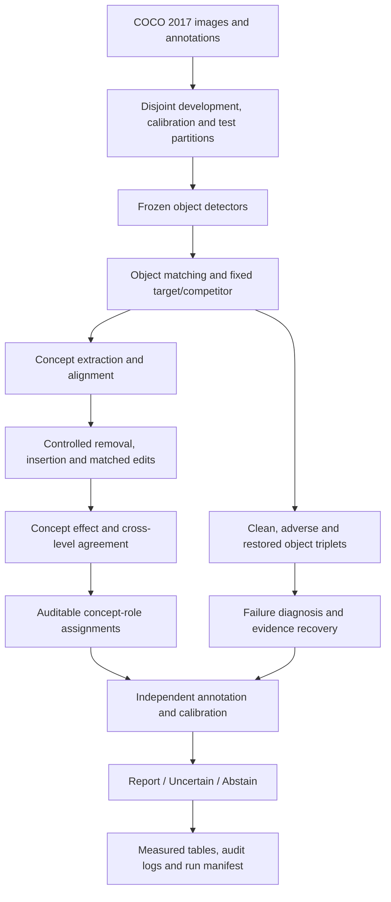

C³R: Auditable Concept Reasoning for Robust Object Detection
C³R is a research framework for studying why frozen object detectors make their predictions, how object-level concept evidence changes under adverse visual conditions, and when an explanation is reliable enough to report.

The framework evaluates contrastive, object-specific explanations through controlled concept interventions, independent role audits, paired degradation–restoration analysis, and calibrated selective reporting. C³R is post-hoc: it does not retrain a detector or claim to improve its detection average precision.
1. Research objectives
- Identify object-level visual concepts relevant to a fixed target-versus-competitor decision.
- Measure the effect of controlled concept removal and bounded insertion against matched intervention controls.
- Assign auditable roles: supporting, conflicting, missing/suppressed, irrelevant, and environmental/spurious. Undetermined is a reporting decision, not a sixth audited role.
- Diagnose co-occurring failure mechanisms under fog, rain, blur, and low illumination.
- Track the same ground-truth object through clean, adverse, and restored observations.
- Calibrate the probability that a reported role is correct, using independent audit labels.
- Compare explanation methods and detector families under a matched evaluation protocol.
2. Evaluation design
Component	Protocol
Primary benchmark	MS COCO 2017
Concept-development partition	2,000 train2017 images, selected and logged before evaluation
Concept dictionary	20 candidate concepts, developed without final-evaluation access
Reliability-calibration partition	500 val2017 images
Final evaluation partition	500 different val2017 images, held out from calibration
Primary detector	Faster R-CNN with ResNet-50 FPN
Additional detectors	YOLOv8m and DETR with ResNet-50
Adverse conditions	Fog, rain, Gaussian/motion blur, low illumination
Model state	Frozen checkpoints throughout explanation evaluation
Statistical unit	Matched objects nested within images; resample by image

The image counts and candidate concept count describe the study configuration, not an assertion that a benchmark run has been completed. Record the exact COCO image IDs and verify that calibration and final-evaluation sets are disjoint.
3. Method overview

Fixed contrastive decision
Each eligible reference object is associated with a target class y* and a plausible competing class y-. The competitor is selected using development or baseline information and never changed after an image edit. Scores, interventions, and restoration measurements use this same comparison.
Controlled concept evaluation
For each concept-object pair, record the edit strength, observed change in the fixed contrastive margin, the corresponding matched-control response, a dose-integrated adjusted effect, and cross-level agreement. Reject edits that fail the registered validity checks. Report uncertainty over independent image clusters rather than treating multiple objects from one image as independent draws.
Concept role assignment
Role	Required evidence
Supporting	Adjusted effect confidence interval above the positive effect margin and sufficient removal agreement
Conflicting	Adjusted effect confidence interval below the negative effect margin and sufficient removal agreement
Missing / suppressed	Concept prior and evidence deficit, verified bounded insertion gain, and insertion agreement
Irrelevant	Effect confidence interval entirely within the prespecified equivalence interval
Environmental / spurious	Predefined nuisance concept together with directional reversal evidence
Undetermined	Evidence does not satisfy a reportable role rule, or validity checks fail

Environmental mechanisms may co-occur with other adverse-condition mechanisms. The final reportable role taxonomy and any priority rules must match the locked implementation protocol.
Object-paired degradation and restoration
Use the same ground-truth box to compute localization IoU at clean (c), adverse (a), and restored (r) stages. Keep matched and unmatched object counts separate. Compute recovery fractions per eligible object before averaging; do not estimate recovery by dividing differences of group means. Restoration claims are restricted to the observed measurements and registered image transformations.
4. Comparison protocol
Explanation baselines are evaluated against the same frozen detector predictions, matched objects, target/competitor choices, edit budget, and partitions.
- Grad-CAM++ with a documented detector-head adaptation.
- D-RISE with its detector-native masking protocol.
- Score-CAM with a documented detector-head adaptation.
- CRAFT or another concept baseline only if a comparable detector/object-level implementation exists.
- Full C³R with contrastive concepts, matched interventions, role reasoning, and calibration.
A baseline that cannot meet the common object-level evaluation contract must be marked unavailable rather than assigned a fabricated score.
5. Required inputs and repository structure
The repository must supply the actual training/inference and evaluation implementation, pinned dependencies, frozen checkpoints, COCO data access, independently adjudicated audit labels, and a configuration file. A recommended artifact organization is:
.
├── README.md
├── requirements.txt
├── configs/
│   └── coco2017.yaml
├── src/
│   └── c3r/
├── scripts/
├── data/
│   ├── annotations/
│   └── splits/
├── checkpoints/
├── audits/
├── outputs/
│   └── <run_id>/
│       ├── manifest.json
│       ├── predictions/
│       ├── interventions/
│       ├── matches/
│       ├── role_audits/
│       ├── calibration/
│       ├── bootstrap/
│       └── tables/
└── tests/
Keep licensed datasets and large model weights outside Git history unless their redistribution permissions explicitly allow inclusion. Record download sources and checksums in the run manifest.
6. Running the study
Execution prerequisite: the repository must contain a working C³R implementation and the assets described above. A manuscript table document by itself is not executable code. The exact shell commands must be taken from the checked-in implementation, not inferred from the manuscript.

A complete research run follows this order:
1. Install the dependencies pinned by the repository and verify CUDA/PyTorch compatibility where a GPU is used.
2. Acquire COCO 2017 images and annotations, then persist the selected development, calibration, and evaluation image IDs.
3. Download or register the selected detector checkpoints, and write their model/configuration hashes to the manifest.
4. Extract frozen detector predictions and match detections against annotated object identities.
5. Freeze each eligible object's target and competing class before applying edits.
6. Develop and align the shared concept dictionary using the development partition only.
7. Run explanation baselines, dose-controlled interventions, and matched-control tests.
8. Construct clean/adverse/restored object triplets and retain unmatched cases.
9. Collect independently adjudicated concept-role and failure-mechanism labels.
10. Fit the reliability calibration model and reporting thresholds on the disjoint calibration partition.
11. Evaluate the locked setup on the final partition; compute image-clustered confidence intervals and apply the declared multiplicity correction.
12. Benchmark time and peak GPU memory on the documented hardware, then export all tables from the stored run artifacts.
Do not set the final-evaluation scores, confidence intervals, model timings, or thresholds by copying values from a manuscript draft. Export them from the corresponding completed run and independently verify the output files.
7. Generated results
Results belong under outputs/<run_id>/tables/. Each table must be generated from corresponding detector records, intervention measurements, independently audited labels, and measured resource logs.
Output	Report content
table_01_protocol.csv	Partitions, detectors, checkpoint IDs, validation controls, and locked settings
table_02_detector_robustness.csv	COCO AP across clean and adverse conditions, adverse object-match recall
table_03_explanation_comparison.csv	Deletion/insertion AUC, contrastive fidelity, box agreement, paired confidence intervals
table_04_concept_interventions.csv	Raw and control effects, adjusted intervention effect, agreement, audited role
table_05_role_audit.csv	Role precision, recall, F1, audit counts, uncertainty, withholding coverage
table_06_restoration.csv	Matched triplets, contrastive margin, ground-truth-box IoU, recovery, unmatched counts
table_07_failure_diagnosis.csv	Multi-label mechanism precision/recall/F1 and recovery consistency
table_08_reliability.csv	Reliability ECE, Brier score, AUROC, NLL, risk-versus-coverage, policy thresholds
table_09_ablations.csv	Module-removal comparisons under fixed checkpoints and identical evaluation objects
table_10_cross_detector.csv	Pairwise concept alignment, sign agreement, spatial overlap, latency, peak VRAM

Metric definitions and integrity checks
- Detection AP is COCO AP averaged over IoU thresholds 0.50 through 0.95. It measures the frozen detector, not an AP improvement produced by C³R.
- Contrastive fidelity must always refer to the prespecified y* versus y- comparison.
- Role metrics require independent adjudication. Withheld/undetermined predictions remain visible in coverage accounting.
- Recovery uses the ground-truth box at clean, adverse, and restored stages; IoU against a clean prediction box is a separate metric.
- Reliability targets denote audited concept-role correctness, not detector classification confidence.
- Selective risk is computed at exact retained coverage with an explicitly stated denominator.
- Calibration is fitted without access to the final evaluation partition. A strictly increasing recalibration must preserve rank-based AUROC and risk at identical ranked coverage.
- Confidence intervals are estimated using image-clustered resampling of measured units, with any registered multiplicity adjustments.
- Latency is measured using a documented device, batch size, synchronization policy, number of warm-up iterations, and number of timed runs.
- Sequential peak VRAM is not computed by summing the peak allocations of separate detector executions.
8. Ablation study
Evaluate the full configuration alongside registered module removals while keeping the detector, image split, object eligibility, edit budget, and evaluator fixed:
- Cross-detector concept alignment
- Full fixed-competitor comparison versus restricted competitor selection
- Matched intervention controls
- Missing-concept reasoning
- Localization-response signals
- Adverse-failure diagnosis
- Image-level validation
- Reliability calibration
- Abstention policy
Use N/A for a metric made undefined by removing its supporting component. A reported difference must come from paired evaluation on matching image units.
9. Reproducibility and provenance
For each run, preserve:
- Code commit, working-tree state, environment lock file, Python/PyTorch/CUDA versions, and operating system.
- Detector checkpoint source, checksum, preprocessor, class mapping, confidence policy, input size, and NMS settings.
- COCO image IDs, split membership, object annotations, eligibility rules, and exclusions.
- Random seed and all corruption/edit seeds, severity settings, and transformation versions.
- Candidate concepts, alignment configuration, fixed class comparisons, intervention masks, and edit-validity results.
- Independent annotation protocol, blinded audit assignments, disagreement resolution, and annotation counts.
- Calibration version and disjoint calibration image IDs; selected reporting thresholds.
- Bootstrap resamples, confidence-interval method, statistical unit, and corrected comparison family.
- Measured hardware, timing methodology, prediction files, confusion matrices, and complete evaluation logs.
Release criterion
A numeric result is ready to publish only when a clean execution with the checked-in source, recorded datasets/checkpoints, frozen configuration, and audit labels can regenerate it within a documented numerical tolerance. Unverified draft values must not be labeled as measured research outcomes.
10. Citation and licensing
Provide the accepted paper citation, software license, pretrained-model licenses, and dataset attribution when those items have been finalized. Cite MS COCO and the original works for each baseline that is actually run.
11. Reproduction status
The experimental design and reporting requirements are specified here. A verified source-code release, exact executable commands, generated prediction logs, and independent audit records are still required before reproducible numerical benchmark results can be claimed.
